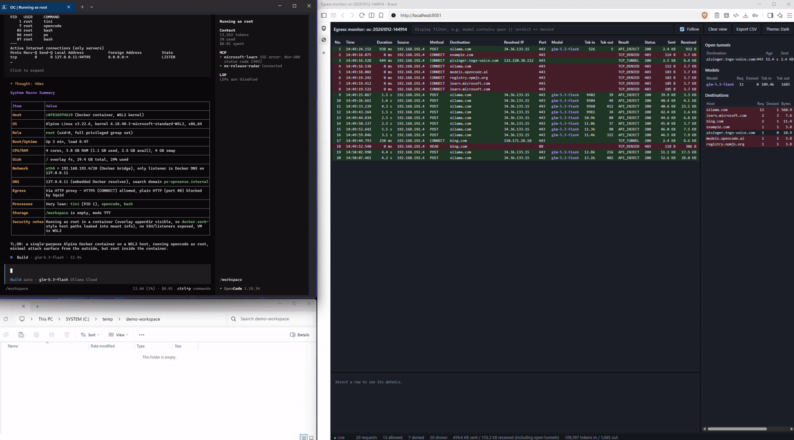

# External agent and container sandbox on WSLc

A PowerShell-driven sandbox for running CLI agents or arbitrary Linux containers with an isolation
boundary built outside the workload. The workload does not need to embed a sandbox SDK or know how
the sidecars are assembled.

The included launchers support **opencode**, **GitHub Copilot CLI**, any locally available image,
and repository folders containing a `Dockerfile`:

- **No direct egress:** the workload runs on an internal WSLc network with no default route.
- **Allowlisted web access:** Squid is the only exit for general tool and web traffic and permits
  only selected domains; bundled Ollama traffic uses the dedicated API proxy.
- **External key handling:** for the bundled Ollama agent scenarios, a separate API proxy holds and
  injects the real model key; the agent sees only a placeholder.
- **Observable sessions:** an optional local monitor shows connections and, on the Ollama API-proxy
  path, model and token usage.
- **Optional Tor path:** tool and web traffic can be forced through an isolated Privoxy/Tor gateway.
- **Disposable lifecycle:** one PowerShell command creates the topology and removes it on exit.
- **Root or non-root agents:** the hardened agent default is non-root, with explicit root opt-in for
  exploratory package installation.

## Project context: why this exists

[Microsoft eXecution Container (MXC)](https://github.com/microsoft/mxc) provides a policy-driven SDK
for applications that need to run untrusted code across several containment backends. One supported
backend is [WSL containers (WSLc)](https://learn.microsoft.com/windows/wsl/wsl-container), the same
Windows container technology used directly by this repository.

MXC is primarily integrated by the host application through its SDK. It also provides standalone
executor binaries for testing or when the SDK cannot be embedded. In either case, MXC validates a
policy, selects a containment backend and launches the workload through its execution model.

This repository does not use the MXC SDK, schema or executors. It explores a narrower, complementary
pattern by wrapping an existing CLI or container from the outside using PowerShell, WSLc networks
and dedicated proxy sidecars. The security boundary is controlled by the operator rather than by
code inside the agent. Inspired by
[Azure Container Apps Sandboxes](https://learn.microsoft.com/azure/container-apps/sandboxes-overview),
it explores a local WSLc-based pattern for wrapping workloads with externally controlled network
boundaries and sidecars.

### When to use it

Use this project when you want to:

- experiment locally with an agent that has no MXC integration;
- place an existing CLI agent behind a destination allowlist without modifying the agent;
- keep an Ollama model credential outside the bundled agent container;
- observe an agent's network destinations before narrowing its allowlist;
- run a custom container with the same proxy-only egress and optional monitor; or
- study and adapt the sidecar topology for your own sandbox design.

Do not treat it as a drop-in implementation of MXC or as a hostile multi-tenant boundary. It has no
MXC policy engine, does not provide per-process filesystem policy, and does not reproduce every MXC
backend or guarantee. The Windows user, host, WSL/WSLc runtime, images and sidecars remain trusted.
Applications in arbitrary images must send web traffic through the supplied HTTP(S) proxy, usually
by honoring its conventional environment variables. See the [security policy](SECURITY.md) for the
complete trust boundary and limitations.

It is also not a local equivalent of Azure Container Apps Sandboxes. The managed service adds
strong multi-tenant isolation, programmable lifecycle control, suspend and resume, snapshots,
persistent volumes, scaling, and broader network policies that this project does not reproduce.



[View the animated demo (GIF)](docs/how-to-get-started.gif)

```
                    oc-int-<session>  (internal: no gateway, no NAT)
 ┌──────────────────────────────────────────────────────────────────────────┐
 │ agent ──HTTP /v1/*──► API proxy ───────── direct HTTPS + real key ──► Ollama
 │   │
 │   └──HTTP(S) proxy──► Squid allowlist ──┬─ normal mode ─────────────► tools
 │                                         └─ Tor mode ─► Privoxy/Tor ─► tools
 └──────────────────────────────────────────────────────────────────────────┘
   agent: internal network only    Tor mode: Squid has no direct-egress interface
```


## Documentation

| Document | Use it for |
|---|---|
| **README** (this page) | Overview, architecture, scenarios and quick start |
| [Configuration reference](docs/CONFIGURATION.md) | Agent modes, credentials, launcher parameters and workspace mounts |
| [Operations guide](docs/OPERATIONS.md) | Builds, recipes, monitoring, verification, logs and troubleshooting |
| [Restricted custom containers](docs/GENERIC-CONTAINERS.md) | Run any image with allowlisted egress and the same sidecars |
| [Security policy](SECURITY.md) | Trust boundary, limitations, safe baseline and vulnerability reporting |
| [Tor mode guide](TOR.md) | Privacy, attribution, governance and responsible-use decisions |
| [Architecture overview](docs/sidecar-architecture-overview.svg) | Presentation-friendly view of the two egress paths |
| [Detailed architecture](docs/sidecar-architecture.svg) | Container and network topology |

## Contents

- **Context:** [Why this exists](#project-context-why-this-exists) · [When to use it](#when-to-use-it) · [Security policy](SECURITY.md)
- **Start:** [Scenarios](#scenarios) · [Prerequisites](#prerequisites) · [Quick start](#quick-start) · [Operations recipes](docs/OPERATIONS.md#recipes)
- **Configure:** [Agent modes](docs/CONFIGURATION.md#agents) · [API key handling](docs/CONFIGURATION.md#api-key-injection) · [Launcher parameters](docs/CONFIGURATION.md#launcher-parameters) · [Workspaces](docs/CONFIGURATION.md#workspace-options)
- **Operate:** [Build and launch recipes](docs/OPERATIONS.md#recipes) · [Monitor](docs/OPERATIONS.md#egress-monitor) · [Logs](docs/OPERATIONS.md#logs) · [Verify isolation](docs/OPERATIONS.md#verify-inside-a-session) · [Troubleshooting](docs/OPERATIONS.md#troubleshooting)
- **Understand:** [Architecture overview](docs/sidecar-architecture-overview.svg) · [Security policy](SECURITY.md) · [Tor guidance](TOR.md)

## Scenarios

| # | Scenario | Command | Containers | Secret inside the agent | Monitor shows model + tokens |
|---|---|---|---|---|---|
| 1 | opencode, Ollama (default) | `.\Start-AgentSidecar.ps1` | agent, squid, api-proxy | placeholder | yes |
| 2 | Copilot BYOK, Ollama | `.\Start-AgentSidecar.ps1 -Agent copilot` | agent, squid, api-proxy | placeholder | yes |
| 3 | Copilot, GitHub models, PAT | `.\Start-AgentSidecar.ps1 -Agent copilot -CopilotAuth github` | agent, squid | **GitHub PAT** | no (TLS to GitHub) |
| 4 | Copilot, GitHub models, device-code sign-in | as 3, plus `-CopilotHomeVolume copilot-home` | agent, squid | **GitHub token** (stored in the volume) | no (TLS to GitHub) |
| 5 | Ollama without injection (diagnostics) | add `-NoKeyInjection` to 1 or 2 | agent, squid | **Ollama key** | no (TLS to Ollama) |
| 6 | Any scenario, no domain restriction | add `-AllowAllDomains` | unchanged | unchanged | unchanged; squid rows for every destination |
| 7 | Agent as root (installs tools itself; allowlist gains `dl-cdn.alpinelinux.org`) | add `-RunAsRoot` | unchanged | unchanged | unchanged |
| 8 | Tool traffic through Tor | add `-Tor` to scenario 1 or 2 | + Tor gateway | placeholder | yes; monitor also shows verified exit IP |
| + | Live monitor | add `-Monitor` to any compatible scenario | + monitor | n/a | as per row |

Scenarios 1 and 2 are the hardened default. 3 to 5 trade key isolation and per-request visibility for functionality, and 6 trades the egress allowlist for convenience, so prefer them only when needed.

**What `-AllowAllDomains` keeps and drops:** the agent still has no route out (internal network), all traffic still goes through squid, and every connection is still logged and visible in the monitor. By default, only `CONNECT` to port 443 is allowed; plain HTTP and other ports stay blocked. What's gone is the destination restriction itself: a prompt-injected agent can send workspace content or a token it holds to any HTTPS site. With key injection the Ollama key remains protected, because it never enters the agent and `ollama.com` stays denied in squid.

Plain HTTP remains disabled by default. `-AllowHttp` additionally permits port 80 to the same
allowlisted destinations (or to any destination when combined with `-AllowAllDomains`). HTTP
requests and responses are unencrypted and can be read or modified in transit; use this only for
legacy endpoints that cannot serve HTTPS.

## Project layout

Each image has its own folder, which is also its build context: a build only sees the files in that folder.

```
wslc-agent-sandbox/
├── agent/                   agent image (opencode or Copilot CLI)
│   ├── Dockerfile
│   ├── entrypoint.sh
│   └── check-proxy-egress.sh
├── proxy/                   squid egress allowlist proxy
│   ├── Dockerfile
│   ├── squid.conf
│   └── proxy-entrypoint.sh
├── api-proxy/               API key injection proxy
│   ├── Dockerfile
│   └── api_proxy.py
├── monitor/                 live egress monitor (web UI)
│   ├── Dockerfile
│   ├── viewer.py
│   └── index.html
├── generic-alpine/          minimal Alpine + Bash example workload
│   └── Dockerfile
├── tor-gateway/             optional unprivileged Privoxy + Tor gateway
│   ├── Dockerfile
│   ├── entrypoint.sh
│   ├── privoxy.config
│   └── torrc
├── docs/
│   ├── how-to-get-started.png   static preview of a session with the egress monitor
│   ├── how-to-get-started.gif   animated demo (loaded on demand)
│   ├── sidecar-architecture.svg
│   ├── sidecar-architecture-overview.svg
│   ├── sidecar-architecture-overview.png
│   ├── sidecar-architecture-overview.json
│   ├── CONFIGURATION.md
│   ├── GENERIC-CONTAINERS.md
│   └── OPERATIONS.md
├── mcp/                      ready-to-copy MCP configuration
│   ├── opencode.json
│   └── copilot.json
├── tests/                    unit tests (python3 -m unittest discover -s tests)
│   └── test_api_proxy.py
├── SECURITY.md              threat model and vulnerability reporting
├── TOR.md                   privacy, attribution and responsible-use guidance
├── Build-AgentImages.ps1    image builder (Windows host)
├── Start-AgentSidecar.ps1   launcher (Windows host)
├── Start-RestrictedContainer.ps1  generic custom-image launcher
├── LICENSE
└── README.md
```

## Files

| File | Purpose |
|---|---|
| `agent/Dockerfile` | Agent image; `--build-arg AGENT=opencode` or `AGENT=copilot` |
| `agent/entrypoint.sh` | Startup: egress self-test; optional root-only packages and privilege drop. Agent phase: per-agent config, exec CLI |
| `agent/check-proxy-egress.sh` | Agent-side self-test, fails closed |
| `api-proxy/Dockerfile`, `api-proxy/api_proxy.py` | API key injection proxy (Python stdlib, non-root) |
| `proxy/Dockerfile`, `proxy/squid.conf`, `proxy/proxy-entrypoint.sh` | Squid allowlist proxy (non-root) |
| `monitor/Dockerfile`, `monitor/viewer.py`, `monitor/index.html` | Optional live egress monitor (web UI) |
| `generic-alpine/` | Minimal Alpine + Bash workload with non-root `sandbox` default, built as `generic-alpine:local` |
| `tor-gateway/` | Optional fail-closed HTTP-parent-to-Tor gateway for Squid traffic |
| `mcp/*.json` | Microsoft Learn and Microsoft Security Release Radar MCP configuration in each agent's native format |
| `Start-AgentSidecar.ps1` | Launcher: networks, API proxy, squid, optional monitor, agent, teardown |
| `Start-RestrictedContainer.ps1` | Runs an arbitrary image with proxy-only egress, optional monitor and Tor |
| `Build-AgentImages.ps1` | Builds all or selected images with `wslc build`; `-Agent opencode\|copilot\|all`, `-Images`, `-Exclude`, `-AgentVersion`, `-NoCache` |
| `tests/test_api_proxy.py` | Unit tests for the API proxy model allowlist (Python stdlib `unittest`) |
| `docs/sidecar-architecture.svg` | Architecture diagram |
| `docs/sidecar-architecture-overview.svg`, `.png`, `.json` | Presentation-style common architecture view and its editable render specification |
| `SECURITY.md` | Supported security scope, known limitations and private reporting instructions |
| `docs/CONFIGURATION.md` | Agent modes, launcher parameters, environment, and workspace configuration |
| `docs/OPERATIONS.md` | Build/run recipes, monitoring, verification, logs, and troubleshooting |
| `docs/GENERIC-CONTAINERS.md` | Generic workload parameters, recipes, lifecycle, and security boundary |
| `TOR.md` | Tor privacy, attribution, governance and responsible-use guidance |

## Prerequisites

- WSL containers with `wslc network create --internal` and `wslc network connect`; the launcher checks for `--internal` and refuses to start without it
- Scenarios 1, 2 and 5: an Ollama Cloud API key. Check the model IDs your key exposes, because `-Models` is also the API proxy's model allowlist: `curl https://ollama.com/v1/models -H "Authorization: Bearer $env:OLLAMA_API_KEY"`
- Scenarios 3 and 4: a GitHub account with a Copilot subscription. No Ollama key is needed
- Optional: the `Microsoft.PowerShell.SecretManagement` and `Microsoft.PowerShell.SecretStore` modules, so the launcher can read keys from a local vault instead of prompting. SecretStore asks for its vault password once per session; `Set-SecretStoreConfiguration -Authentication None -Interaction None` removes the prompt but leaves the vault readable by anyone running as your Windows user

## Quick start

```powershell
# 1. Build the images (from the project root; each folder is its own build context)
.\Build-AgentImages.ps1                       # all known images + discovered Dockerfile folders
.\Build-AgentImages.ps1 -Agent opencode       # only the opencode agent image (+ all sidecars)
.\Build-AgentImages.ps1 -Agent copilot -Exclude tor-gateway   # Copilot agent, no Tor gateway

#    or manually with wslc:
wslc build -t opencode-alpine:local --build-arg AGENT=opencode agent
wslc build -t copilot-alpine:local  --build-arg AGENT=copilot  agent
wslc build -t agent-api-proxy:local api-proxy
wslc build -t agent-egress-proxy:local proxy
wslc build -t agent-egress-monitor:local monitor   # only for -Monitor
wslc build -t agent-tor-gateway:local tor-gateway  # only for -Tor
wslc build -t generic-alpine:local generic-alpine  # example custom workload

# 2. Store secrets once (optional, recommended)
#    One-time vault setup (SecretManagement + SecretStore vault):
Install-Module Microsoft.PowerShell.SecretManagement, Microsoft.PowerShell.SecretStore -Scope CurrentUser
Register-SecretVault -Name LocalStore -ModuleName Microsoft.PowerShell.SecretStore -DefaultVault
Import-Module Microsoft.PowerShell.SecretManagement   # optional; PowerShell 7 autoloads it on first Get-Secret
Set-Secret -Name OllamaApiKey       -Secret (Read-Host "OLLAMA_API_KEY" -AsSecureString)   # scenarios 1, 2, 5
Set-Secret -Name CopilotGithubToken -Secret (Read-Host "GitHub PAT" -AsSecureString)       # scenario 3

# 3. Start a session
.\Start-AgentSidecar.ps1                      # opencode, key injection on
.\Start-AgentSidecar.ps1 -Agent copilot       # Copilot CLI, key injection on
.\Start-AgentSidecar.ps1 -Agent copilot -Monitor
.\Start-AgentSidecar.ps1 -Agent copilot -CopilotAuth github                      # GitHub models (PAT)
.\Start-AgentSidecar.ps1 -Agent copilot -CopilotAuth github -CopilotHomeVolume copilot-home   # device-code sign-in
.\Start-AgentSidecar.ps1 -Agent copilot -Workspace C:\src\myrepo -WorkspaceReadOnly   # existing folder
.\Start-AgentSidecar.ps1 -Tor -Monitor              # tool traffic via Tor; model API stays direct
```

To run a non-agent image with the same egress restriction and monitor:

```powershell
.\Build-AgentImages.ps1 -Images proxy,monitor,generic-alpine
.\Start-RestrictedContainer.ps1 -Image generic-alpine:local -Shell -Monitor
.\Start-RestrictedContainer.ps1 -Image generic-alpine:local -Shell -ShellPath /bin/bash -Monitor
.\Start-RestrictedContainer.ps1 -Image generic-alpine:local -Shell -RunAsRoot -Monitor  # enables apk downloads
.\Start-RestrictedContainer.ps1 -Image generic-alpine:local -Shell -RunAsRoot -AllowHttp -Monitor  # only for HTTP repositories/endpoints
```

The standard Alpine repositories use HTTPS, so ordinary `apk add --no-cache <package>` only needs
`-RunAsRoot`; it does not need `-AllowHttp`. Add `-AllowHttp` only when the workload deliberately
uses an allowlisted plain-HTTP repository or endpoint.

Both supplied workload images have safe image-level defaults: the agent image declares
`USER agent`, and `generic-alpine` declares `USER sandbox` (both UID 1000). `-RunAsRoot` is an
explicit runtime override. For agent sessions, `-ApkPackages` also starts the container as UID 0
temporarily, installs the requested packages, and then drops back to `agent` before the CLI starts.

See [Restricted custom containers](docs/GENERIC-CONTAINERS.md) for mounts, environment variables,
localhost port publishing, deny-all operation, destination discovery, and Tor mode.

The build script also handles new images dynamically. Add a root-level folder containing a
`Dockerfile`; the default `-Images all` discovers it automatically, or select it by folder name:

```powershell
# ./my-container/Dockerfile
.\Build-AgentImages.ps1 -Images my-container   # creates my-container:local
.\Start-RestrictedContainer.ps1 -Image my-container:local -Shell -Monitor
```

No build-script catalog change is needed for ordinary custom image folders. The catalog is retained
only for existing images that need special tags or build arguments.

### What needs rebuilding

The launcher does not build images automatically. Rebuild only the image whose source folder
changed, then start a new session; running containers never acquire rebuilt files.

| Changed path | Rebuild command |
|---|---|
| `agent/` | `.\Build-AgentImages.ps1 -Images opencode,copilot` (or only one of them) |
| `api-proxy/` | `.\Build-AgentImages.ps1 -Images api-proxy` |
| `proxy/` | `.\Build-AgentImages.ps1 -Images proxy` |
| `monitor/` | `.\Build-AgentImages.ps1 -Images monitor` |
| `tor-gateway/` | `.\Build-AgentImages.ps1 -Images tor-gateway` |
| `generic-alpine/` | `.\Build-AgentImages.ps1 -Images generic-alpine` |
| `Start-AgentSidecar.ps1`, `Start-RestrictedContainer.ps1`, `Build-AgentImages.ps1`, `mcp/`, `tests/`, Markdown docs, architecture diagrams | No image rebuild |

