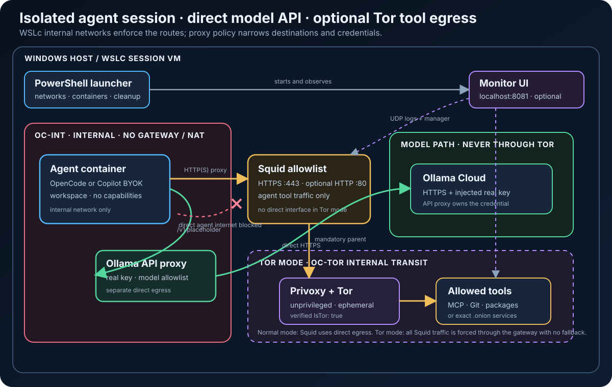

# Isolated agent sessions on WSL containers (wslc)

Isolated sessions for **opencode** or **GitHub Copilot CLI** on WSL containers, using Ollama Cloud models (default) or GitHub Copilot models. No extra container capabilities are needed:

- **Network isolation:** the agent runs on an internal network with no route out.
- **Egress allowlist:** a squid proxy is the only exit for general traffic, and forwards only allowlisted domains.
- **API key injection (default for Ollama):** a separate API proxy holds the real Ollama key and adds it to model requests. The agent only ever sees a placeholder.
- **Optional Tor mode:** general Squid traffic can be forced through an isolated Privoxy/Tor gateway while model API traffic stays direct through the API proxy.

```
                    oc-int-<session>  (internal: no gateway, no NAT)
 ┌──────────────────────────────────────────────────────────────────────────┐
 │ agent ──HTTP /v1/*──► API proxy ───────── direct HTTPS + real key ──► Ollama
 │   │
 │   └──HTTP(S) proxy──► Squid allowlist ──┬─ normal mode ─────────────► tools
 │                                         └─ Tor mode ─► Privoxy/Tor ─► tools
 └──────────────────────────────────────────────────────────────────────────┘
   agent: internal network only    Tor mode: Squid has no direct-egress interface
```



## Documentation

| Document | Use it for |
|---|---|
| **README** (this page) | Overview, architecture, scenarios and quick start |
| [Configuration reference](docs/CONFIGURATION.md) | Agent modes, credentials, launcher parameters and workspace mounts |
| [Operations guide](docs/OPERATIONS.md) | Builds, recipes, monitoring, verification, logs and troubleshooting |
| [Security policy](SECURITY.md) | Trust boundary, limitations, safe baseline and vulnerability reporting |
| [Tor mode guide](TOR.md) | Privacy, attribution, governance and responsible-use decisions |
| [Architecture overview](docs/sidecar-architecture-overview.svg) | Presentation-friendly view of the two egress paths |
| [Detailed architecture](docs/sidecar-architecture.svg) | Container and network topology |

## Contents

- **Start:** [Scenarios](#scenarios) · [Prerequisites](#prerequisites) · [Quick start](#quick-start) · [Operations recipes](docs/OPERATIONS.md#recipes)
- **Configure:** [Agent modes](docs/CONFIGURATION.md#agents) · [API key handling](docs/CONFIGURATION.md#api-key-injection) · [Launcher parameters](docs/CONFIGURATION.md#launcher-parameters) · [Workspaces](docs/CONFIGURATION.md#workspace-options)
- **Operate:** [Build and launch recipes](docs/OPERATIONS.md#recipes) · [Monitor](docs/OPERATIONS.md#egress-monitor) · [Logs](docs/OPERATIONS.md#logs) · [Verify isolation](docs/OPERATIONS.md#verify-inside-a-session) · [Troubleshooting](docs/OPERATIONS.md#troubleshooting)
- **Understand:** [Architecture overview](docs/sidecar-architecture-overview.svg) · [Security policy](SECURITY.md) · [Tor guidance](TOR.md)

## Scenarios

| # | Scenario | Command | Containers | Secret inside the agent | Monitor shows model + tokens |
|---|---|---|---|---|---|
| 1 | opencode, Ollama (default) | `.\Start-AgentSidecar.ps1` | agent, squid, api-proxy | placeholder | yes |
| 2 | Copilot BYOK, Ollama | `.\Start-AgentSidecar.ps1 -Agent copilot` | agent, squid, api-proxy | placeholder | yes |
| 3 | Copilot, GitHub models, PAT | `.\Start-AgentSidecar.ps1 -Agent copilot -CopilotAuth github` | agent, squid | **GitHub PAT** | no (TLS to GitHub) |
| 4 | Copilot, GitHub models, device-code sign-in | as 3, plus `-CopilotHomeVolume copilot-home` | agent, squid | **GitHub token** (stored in the volume) | no (TLS to GitHub) |
| 5 | Ollama without injection (diagnostics) | add `-NoKeyInjection` to 1 or 2 | agent, squid | **Ollama key** | no (TLS to Ollama) |
| 6 | Any scenario, no domain restriction | add `-AllowAllDomains` | unchanged | unchanged | unchanged; squid rows for every destination |
| 7 | Agent as root (installs tools itself) | add `-RunAsRoot` | unchanged | unchanged | unchanged |
| 8 | Tool traffic through Tor | add `-Tor` to scenario 1 or 2 | + Tor gateway | placeholder | yes; monitor also shows verified exit IP |
| + | Live monitor | add `-Monitor` to any compatible scenario | + monitor | n/a | as per row |

Scenarios 1 and 2 are the hardened default. 3 to 5 trade key isolation and per-request visibility for functionality, and 6 trades the egress allowlist for convenience, so prefer them only when needed.

**What `-AllowAllDomains` keeps and drops:** the agent still has no route out (internal network), all traffic still goes through squid, and every connection is still logged and visible in the monitor. By default, only `CONNECT` to port 443 is allowed; plain HTTP and other ports stay blocked. What's gone is the destination restriction itself: a prompt-injected agent can send workspace content or a token it holds to any HTTPS site. With key injection the Ollama key remains protected, because it never enters the agent and `ollama.com` stays denied in squid.

Plain HTTP remains disabled by default. `-AllowHttp` additionally permits port 80 to the same
allowlisted destinations (or to any destination when combined with `-AllowAllDomains`). HTTP
requests and responses are unencrypted and can be read or modified in transit; use this only for
legacy endpoints that cannot serve HTTPS.

## Project layout

Each image has its own folder, which is also its build context: a build only sees the files in that folder.

```
opencode-wslc/
├── agent/                   agent image (opencode or Copilot CLI)
│   ├── Dockerfile
│   ├── entrypoint.sh
│   └── check-proxy-egress.sh
├── proxy/                   squid egress allowlist proxy
│   ├── Dockerfile
│   ├── squid.conf
│   └── proxy-entrypoint.sh
├── api-proxy/               API key injection proxy
│   ├── Dockerfile
│   └── api_proxy.py
├── monitor/                 live egress monitor (web UI)
│   ├── Dockerfile
│   ├── viewer.py
│   └── index.html
├── tor-gateway/             optional unprivileged Privoxy + Tor gateway
│   ├── Dockerfile
│   ├── entrypoint.sh
│   ├── privoxy.config
│   └── torrc
├── docs/
│   ├── sidecar-architecture.svg
│   ├── sidecar-architecture-overview.svg
│   ├── sidecar-architecture-overview.png
│   ├── sidecar-architecture-overview.json
│   ├── CONFIGURATION.md
│   └── OPERATIONS.md
├── mcp/                      ready-to-copy MCP configuration
│   ├── opencode.json
│   └── copilot.json
├── SECURITY.md              threat model and vulnerability reporting
├── TOR.md                   privacy, attribution and responsible-use guidance
├── Start-AgentSidecar.ps1   launcher (Windows host)
└── README.md
```

## Files

| File | Purpose |
|---|---|
| `agent/Dockerfile` | Agent image; `--build-arg AGENT=opencode` or `AGENT=copilot` |
| `agent/entrypoint.sh` | Root phase: packages, egress self-test, privilege drop. Agent phase: per-agent config, exec CLI |
| `agent/check-proxy-egress.sh` | Agent-side self-test, fails closed |
| `api-proxy/Dockerfile`, `api-proxy/api_proxy.py` | API key injection proxy (Python stdlib, non-root) |
| `proxy/Dockerfile`, `proxy/squid.conf`, `proxy/proxy-entrypoint.sh` | Squid allowlist proxy (non-root) |
| `monitor/Dockerfile`, `monitor/viewer.py`, `monitor/index.html` | Optional live egress monitor (web UI) |
| `tor-gateway/` | Optional fail-closed HTTP-parent-to-Tor gateway for Squid traffic |
| `mcp/*.json` | Microsoft Learn and Microsoft Security Release Radar MCP configuration in each agent's native format |
| `Start-AgentSidecar.ps1` | Launcher: networks, API proxy, squid, optional monitor, agent, teardown |
| `docs/sidecar-architecture.svg` | Architecture diagram |
| `docs/sidecar-architecture-overview.svg`, `.png`, `.json` | Presentation-style common architecture view and its editable render specification |
| `SECURITY.md` | Supported security scope, known limitations and private reporting instructions |
| `docs/CONFIGURATION.md` | Agent modes, launcher parameters, environment, and workspace configuration |
| `docs/OPERATIONS.md` | Build/run recipes, monitoring, verification, logs, and troubleshooting |
| `TOR.md` | Tor privacy, attribution, governance and responsible-use guidance |

## Prerequisites

- WSL containers with `wslc network create --internal` and `wslc network connect`; the launcher checks for `--internal` and refuses to start without it
- Scenarios 1, 2 and 5: an Ollama Cloud API key. Check the model IDs your key exposes, because `-Models` is also the API proxy's model allowlist: `curl https://ollama.com/v1/models -H "Authorization: Bearer $env:OLLAMA_API_KEY"`
- Scenarios 3 and 4: a GitHub account with a Copilot subscription. No Ollama key is needed

## Quick start

```powershell
# 1. Build the images (from the project root; each folder is its own build context)
wslc build -t opencode-alpine:local --build-arg AGENT=opencode agent
wslc build -t copilot-alpine:local  --build-arg AGENT=copilot  agent
wslc build -t agent-api-proxy:local api-proxy
wslc build -t agent-egress-proxy:local proxy
wslc build -t agent-egress-monitor:local monitor   # only for -Monitor
wslc build -t agent-tor-gateway:local tor-gateway  # only for -Tor

# 2. Store secrets once (optional, recommended)
Set-Secret -Name OllamaApiKey       -Secret (Read-Host "OLLAMA_API_KEY" -AsSecureString)   # scenarios 1, 2, 5
Set-Secret -Name CopilotGithubToken -Secret (Read-Host "GitHub PAT" -AsSecureString)       # scenario 3

# 3. Start a session
.\Start-AgentSidecar.ps1                      # opencode, key injection on
.\Start-AgentSidecar.ps1 -Agent copilot       # Copilot CLI, key injection on
.\Start-AgentSidecar.ps1 -Agent copilot -Monitor
.\Start-AgentSidecar.ps1 -Agent copilot -CopilotAuth github                      # GitHub models (PAT)
.\Start-AgentSidecar.ps1 -Agent copilot -CopilotAuth github -CopilotHomeVolume copilot-home   # device-code sign-in
.\Start-AgentSidecar.ps1 -Agent copilot -Workspace C:\src\myrepo -WorkspaceReadOnly   # existing folder
.\Start-AgentSidecar.ps1 -Tor -Monitor              # tool traffic via Tor; model API stays direct
```

### What needs rebuilding

The launcher does not build images automatically. Rebuild only the image whose source folder
changed, then start a new session; running containers never acquire rebuilt files.

| Changed path | Rebuild command |
|---|---|
| `agent/` | `wslc build -t opencode-alpine:local --build-arg AGENT=opencode agent` and/or the equivalent `copilot-alpine:local` build |
| `api-proxy/` | `wslc build -t agent-api-proxy:local api-proxy` |
| `proxy/` | `wslc build -t agent-egress-proxy:local proxy` |
| `monitor/` | `wslc build -t agent-egress-monitor:local monitor` |
| `tor-gateway/` | `wslc build -t agent-tor-gateway:local tor-gateway` |
| `Start-AgentSidecar.ps1`, `mcp/`, Markdown docs, architecture diagrams | No image rebuild |

